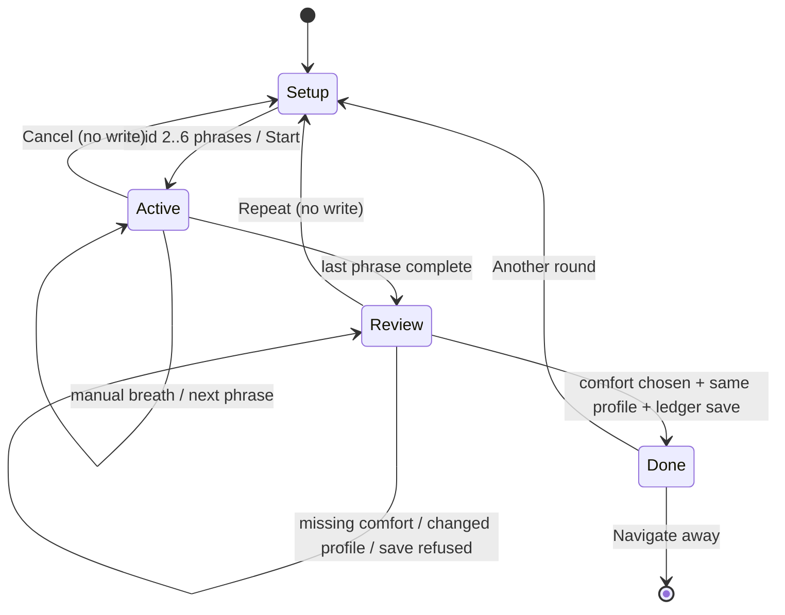
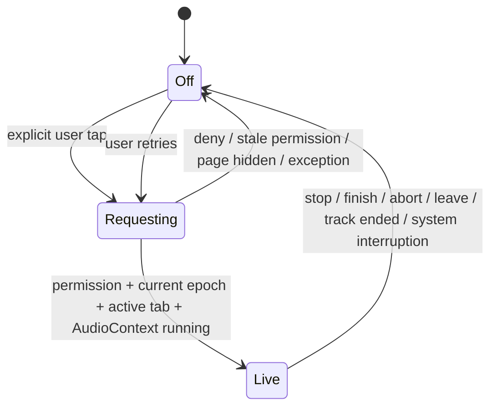
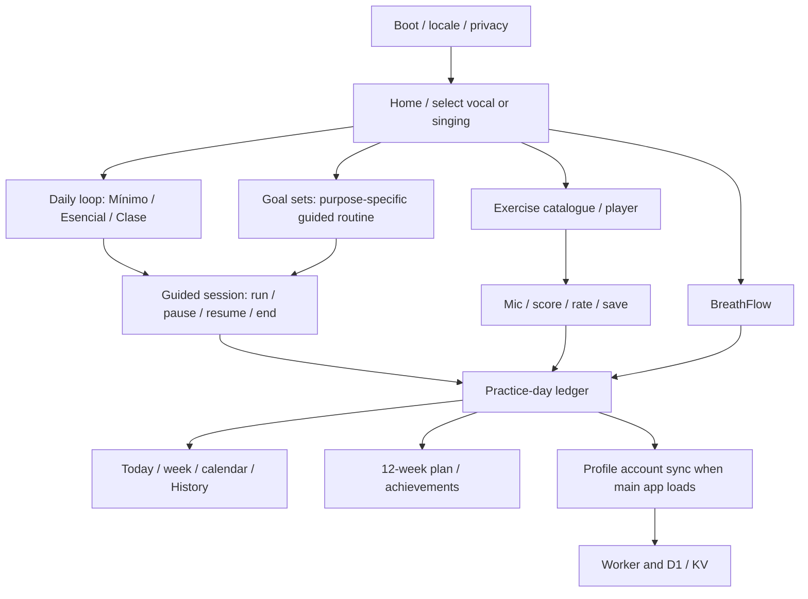

# 49 — BreathFlow: phrase breathing, state machines and integration map (2026-11-22)

**Status:** implementation on `feature/breathflow-20261122`, awaiting CI and real-device gates. Not a medical device, breath-rate test, respiratory strength test, or clinically validated classifier.

## 1. Coaching source and evidence boundary

The coaching conversation of 8 November emphasised that a comfortable breath belongs at **meaningful phrase boundaries**, not reflexively after every word; carry projection and intention through each phrase without pushing. The question raised afterward was whether the microphone could help *notice* breaths. It can suggest noisy, nearby candidate sounds, **not** confirm an inhalation or measure lung mechanics.

BreathFlow is a rehearsal aid, not a breath-holding contest. A comfortable, conversational inhale is sufficient. The technique literature does not justify imposing a fixed 4-in/6-out breathing rhythm on every singer. A 2026 narrative review argues for attention to controlled expiration, not an exclusive focus on larger inspiration (PMID 42463357). A 2026 systematic review of respiratory training in singers and instrumentalists discusses interventions but does **not** validate acoustic breath classification by laptop or phone (PMID 42185121). Clinical voice studies apply to specific populations and protocols, not directly to healthy home singers (ASHA voice disorders portal; PMC12270840). The heuristic in this build has **no sensitivity/specificity calibration**. It may respond to clothing, sibilants, air conditioning, room noise, music, or handling.

Stop if dizziness, pain, breathlessness or vocal fatigue appears. Seek a qualified voice specialist for persistent voice symptoms rather than training through pain.

## 2. User journey and deliberately limited gamification

1. **First visit:** home → *Otras formas de practicar* → BreathFlow; choose *Iniciación*, *Narración* or *Transferencia*. Defaults to a short original Spanish script; optionally replace it with **your own** 2–6 lines. The page does not transmit or persist the lines.
2. **Plan:** each phrase boundary has an optional planned breath (none required after the last phrase). The opening breath is not scored.
3. **Microphone (optional):** after an explicit tap, permission request, local noise calibration and possible acoustic hints; manual breathing buttons always work. Audio never becomes a saved recording or network request.
4. **Rehearse:** say or sing each phrase, mark breaths just before a phrase or within it, tap *Siguiente*; there is no penalty, streak break, score or count-for-duration mechanic.
5. **Review:** see planned and self-confirmed count, optional unverified acoustic candidate count, then rate **comfort** before Save; cancellation creates no ledger entry.
6. **Save:** writes one `VTDays.record({ exerciseId: 'bf-breathflow', saved: true })` to the existing profile's day ledger. The daily, weekly and monthly tabs all read the **same** `vt_days_v1` record. A day counts once; repeats increment the day's activity count, not unique days. After navigating to the main app the existing account sync machinery can upload the ledger.
7. **Return/switch:** return to setup to repeat, to the main app for the existing plan/history, or switch period with keyboard arrows. Profile switching between start and save fails closed.

**Existing gamification:** don't build parallel XP. PR #47 (*Tu camino*) already supplies day-based area growth and non-coercive milestones, opt-out, ledger-derived rewards, cohort tests and dedicated tests; integrate after its separate review. BreathFlow intentionally contributes an activity to the same calendar but does **not** add a new achievement criterion or score. The monthly tab is a **read-only progress summary**, not a second monthly planner; the application's planning authority remains the existing 12-week plan, daily routine and weekly range goals.

## 3. Explicit state machines and invariants

### A. BreathFlow learning session (implemented)

Guards: no save in Setup/Active; no write on Cancel; no more than one Save per run (`state.saved`); caller's profile ID must equal the ID on Start; all phrase text rendered with `textContent`, never HTML; review metrics are self-reported.

### B. Microphone resource (implemented, independent of session)

Single resource owner (`MediaStream` and `AudioContext`). `epoch` discards permission results arriving after cancel/leave. Temporary mute displays a diagnostic; device loss/visibility change tears down and permits manual continuation. The heuristic must abstain whenever the signal cannot support a verified event. **Neither calibration nor frame timestamps constitute a validated inhale oracle.** iOS Safari has additional `interrupted` states and the real-device matrix remains open.

### C. Existing app navigation and learning paths (inventory)

This is the **entry and dependency map**, not an assertion that all tabs were successfully click-tested in this change. The actual exercise player keeps its own stage, recorder, pitch DSP and session banner state; BreathFlow does not mutate these live resources.

### D. Shared state-machine ledger

| State owner | States / transitions | Durable authority | Cross-screen invariant | Existing code |
|---|---|---|---|---|
| Boot + locale | init → ready → re-render / error | browser locale/settings | text and controls redraw after language change | `boot-head.js`, `boot-ready.js`, `i18n.js` |
| Navigation/design | Home ↔ Exercise ↔ Plan ↔ History, A/B layouts | route + `VT_SETTINGS` | page switches must not interrupt an ongoing take invisibly | `app.js`, `site-version.js` |
| Daily routine | tier select → guided run → done | `vt_loop_v1` + `VT_SESSION` | only a finished basics routine marks basics | `daily-loop.js`, `session.js` |
| Goal sets | picker → running set → completion card | `VT_SESSION` + day ledger | finishing set does not mark daily basics | `session-sets.js` |
| 12-week plan | idle → active → review / next week | `vt_week_plan_v1` | advancement cannot silently replace a different profile's plan | `app.js`, `storage.js` |
| Recorder | requesting → recording → stopping → finalizing → stored | IndexedDB for audio, local progress for take | no double take from auto-save and later rating | `recorder.js`, `app.js` |
| Mic/audio DSP | permission → stream → output / interruption / stop | ephemeral MediaStream and Web Audio | output restart never implicitly awards a take | `audio-recovery.js`, `voice-features.js`, scene modules |
| Exercise review | recording/done → rating → saved | `vt_progress_v1` | re-rating uses existing take ID | `storage.js` |
| Day/rest-day ledger | new day → practised / rest / missed → covered | `vt_days_v1` | local calendar day, one counted day, per-profile | `practice-days.js` |
| Weekly range + return | goal chosen → observed week → comeback | `vt_loop_v1` + days | one weekday boundary; rest does not count as practice | `daily-loop.js` |
| Achievements | eligible → earned → seen / hidden | `vt_achievements_v1` and loop, when PR #47 merges | achievements never infer skill and never decay | PR #47 `voice-path.js` |
| Cross-device sync | dirty → read → merge → conditional revision write → retry / conflict | per-profile cloud doc + client bag | no stale account takeover or overwritten newer revision | `sync.js`, Worker `progress.js` |
| Session / identity | signed-out → challenge → signed-in → refresh/expiry → signed-out | Worker D1/KV tokens | no crossover of profiles/accounts | `auth.js`, `account.js`, Worker accounts |
| Subscription | checkout → provider event → entitlement → renewal/cancel/refund | Worker D1/KV + signed license | provider replay/idempotence; no 'paid' UI before grant | Worker billing/events/grants/ledger |

## 4. Architecture + operational location

| Component | Where | Operational check |
|---|---|---|
| Repository/source/docs | `github.com/PillB/vocal-singing-training`; `docs/`, `AGENTS.md` | PR diff + Actions |
| Site/HTML/JS | `https://pillb.github.io/vocal-singing-training/`; GitHub Pages from `main` root | public page and deployed SHA parity |
| Backend | Cloudflare Worker `vocal-studio-entitlements` (`workers/entitlements/src/`) | health endpoint + Worker logs |
| Primary account/progress DB | Cloudflare D1 `vocal-studio-accounts`, `DB` binding | migrations/schema, Worker consistency |
| KV | Cloudflare `ENTITLEMENTS` binding | idempotent claims/license and configured namespaces |
| Local progress | `localStorage` namespaced by active profile | quota, offline, private browsing |
| Audio recordings | IndexedDB **only in browser** | browser storage eviction, no account audio sync |
| CI | `.github/workflows/quality.yml`, `health-ping.yml` | Actions status, tests/QA reports |
| Deploy config | `workers/entitlements/wrangler.toml` | checked-in binding IDs are `TODO_REPLACE_...`; actual deployed config cannot be inferred from this repo |

No stand-alone Postgres connection pool exists in the documented app stack. D1 is accessed through its managed Worker binding. Cloudflare Hyperdrive/connection pooling is relevant **only** if the app later connects to an external SQL server. Do not introduce a pool for D1 as a performative refactor. Use D1 transactions/batching and appropriately scoped writes where atomicity actually matters.

## 5. Root-cause and risk ledger — falsifiable conditions

| Issue | Failure mode + hypothesis | Decision / guard | Test oracle and residual risk |
|---|---|---|---|
| BF-01 profile leak | switching profile between exercise start and Save credits wrong owner | capture owner at start, reject change at Save | `breathflow.spec.js` profile-switch test; account cross-device still untested |
| BF-02 double award | repeated Save creates duplicate day's exercise count | disable repeat via `state.saved` | doubleclick gives `n=+1`; reload between writes not transactionally deduped |
| BF-03 mic race | permission arrives after Abort / navigation; unseen stream stays live | `epoch`, release stale stream, stop on `pagehide` | denied + manual path tested; late permission and iOS suspended lifecycle require further tests |
| BF-04 source confusion | silence or sibilance called a confirmed inhale | label candidate, don't feed into rating | acoustic sensitivity/specificity **not measured**; real recordings required |
| BF-05 sync mismatches | a child page writes days without loading full auth/sync app | use same VTDays/VTStorage source; main app subsequently syncs | local cross-tab event and main re-open; cloud sync not yet verified |
| BF-06 no storage | quota/private mode refuses persistence but UI says success | warn and keep review visible | storage refused test needed, and day ledger is in-memory until reload |
| BF-07 phone mic/audio | Safari interruption, browser background, muted track, headset switch | explicit stop and fallback | physical iPhone 13 Safari required |
| BF-08 conflicting planners | making parallel weekly/monthly exercise menus drifts from 12-week plan | render summaries from same ledger; no new planning authority | main tabs vs BreathFlow after each save, manual QA still required |
| BF-09 game harms voice | points for loudness, longest hold or no breaths induce strain | only days/completion, perceived comfort; no XP | clinician review and actual user research |
| BF-10 stale asset | old cached script runs under newly delivered HTML | versioned URL + manifest SHA, same CSP | `npm run lint` asset gate; deploy parity gate |
| BF-11 external payment races | concurrent grant and webhook replay doubles entitlements | preserve current Worker ledger and atomicity tests, separate feature | review PR #41 and Worker test suite before changing |
| BF-12 unfounded research claims | app presents heuristic as a lung-function or voice-quality score | abstaining wording and human confirmation | check both language and clinician reading; no clinical validity claim |

## 6. Patterns: use the right one at the right boundary

- **Optimistic concurrency:** already implemented in `js/sync.js` (revision-based read-merge-write with retries); review invariant: a conflict must re-fetch and merge, never blindly overwrite. Use monotonic revision guards for any future per-phrase online planning document; do not create a second persistence authority here.
- **Outbox pattern:** relevant to D1-backed *payment and notification side effects* that must survive a Worker crash after a committed write. If the current event/ledger paths lack a durable outbox, add a separate DB table with event ID, attempt count, next retry and terminal state, plus idempotent consumer. **Not** needed for BreathFlow, which performs one local ledger write and no external side effect.
- **Connection pooling:** not applicable to D1 bindings; Hyperdrive is for Workers talking to external databases.
- **Finite-state ownership:** use an explicit transition ledger, prevent late permission results, use single mic owner, cancel on visibility loss. Never let a second microphone exerciser open concurrently on the same page.
- **Local first + privacy by design:** avoid persisting lyric text and audio; treat acoustic data as transient. Fail visibly if browser storage refuses.

## 7. Four red-team passes requested for this change

**RT1 Input and scientific validity.** Adversarial HTML/text, long/short phrases, empty lines, no breath, repeated breath marks, loud room/noisy breath classifier. Correct result: text rendered harmlessly, invalid text blocked, no audio-based inhale certification. Automated tests cover text and length; noisy real audio **open**.

**RT2 Async state and identity.** Cancel before permission returns, repeated Start/Save, profile switch, background tab, manual fallback. Epoch/profile guard in place. Automated tests cover repeated save/profile/denied; late GUM response, quota and finalization race **open**.

**RT3 Accessibility, locale and mobile.** 360×740 and 390×844, landscape 844×390, 200% zoom, keyboard role tablist, 44px targets, reduced motion and focus. One Playwright mobile and keyboard test added; real Safari, full matrix and English copy translation **open** (BreathFlow's content is currently Spanish-first; source app is bilingual).

**RT4 Integration, privacy, operational.** Ledger day/week/month and main app sync, CSP parity, asset cache version, switching all main tabs, login/logout, payments, analytics traffic, workers/CI, deploy SHA. Script and page share the repository CSP, local ledger reuse, CI tests added. Cloud account sync, all navigation combinations and production smoke checks **open** until confirmed.

## 8. Release gates

1. `npm run lint`, `npm run test:core`, `npx playwright test tests/breathflow.spec.js --project=chromium` all green, plus CSP/asset checks and a falsifiable mutation test.
2. Test the whole first-use and day/week/month navigation in **both** site designs (including PR #47's overlay when integrated), 360×740 / 390×844 / 844×390 / desktop; simulate permission denial, delayed permission, network loss, profile swap, quota, reload, keyboard and 200% zoom.
3. Compare the same ledger on Home, Calendar, Plan and BreathFlow after each save; verify cloud backfill from a different browser.
4. Physical iPhone Safari microphone/foreground/background/call/AirPods tests, plus a small human voice sample corpus against manually annotated breaths, where false positives and false negatives must be reported (not claimed as a diagnostic).
5. Only after gates: merge this PR, let Pages publish, compare published `main` SHA and served script version, rerun smoke. Real-device gates can't be replaced with WebKit emulation.

## 9. Research references

- ASHA Voice Disorders practice portal: https://www.asha.org/practice-portal/clinical-topics/voice-disorders/
- Breath management narrative review 2026, PMID 42463357: https://pubmed.ncbi.nlm.nih.gov/42463357/
- Systematic review and meta-analysis 2026, PMID 42185121: https://pubmed.ncbi.nlm.nih.gov/42185121/
- Speech breathing randomised trial (population-specific): https://pmc.ncbi.nlm.nih.gov/articles/PMC12270840/
- MDN getUserMedia: https://developer.mozilla.org/en-US/docs/Web/API/MediaDevices/getUserMedia
- MDN BaseAudioContext state, iOS interruption: https://developer.mozilla.org/en-US/docs/Web/API/BaseAudioContext/state
- Cloudflare D1 Workers API: https://developers.cloudflare.com/d1/worker-api/d1-database/
- Cloudflare database connection patterns: https://developers.cloudflare.com/workers/databases/connecting-to-databases/
- Existing project research: `docs/37-DAILY-LOOP.md`, `docs/44-PROTOCOLO-TECNICO-VOCAL-EVIDENCIA-2026-11-06.md`, `docs/47-SESSION-SETS.md`, and PR #47 `docs/48-TU-CAMINO.md`.
