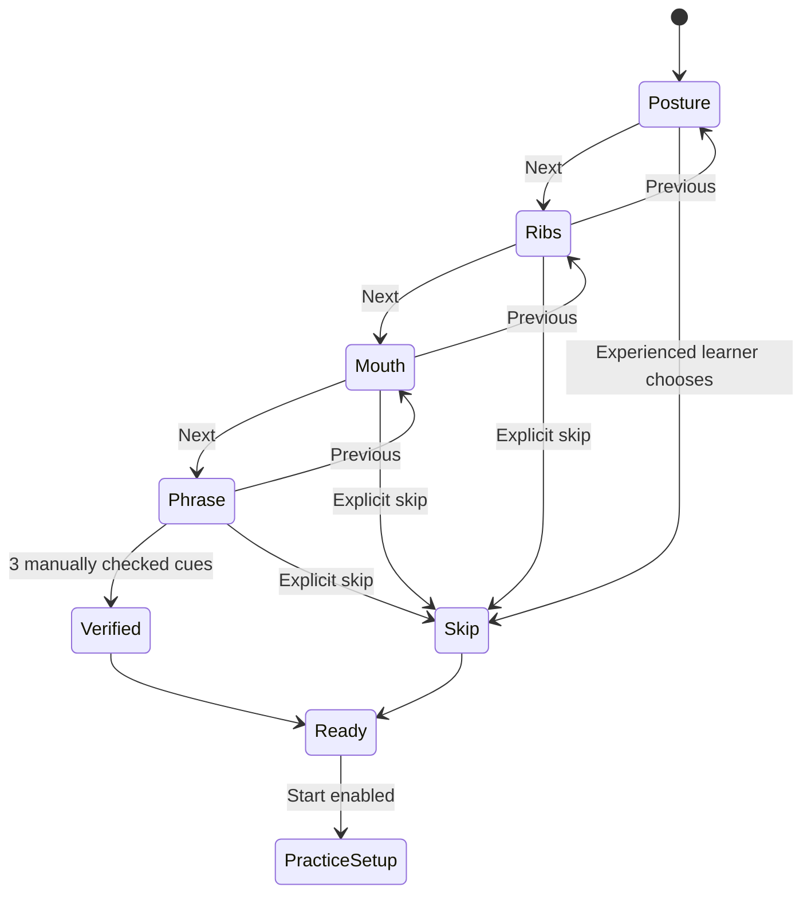
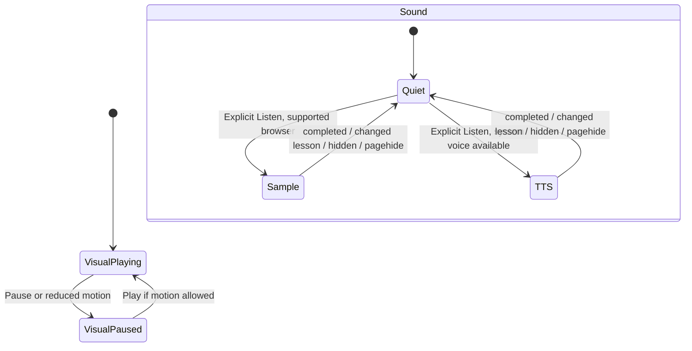
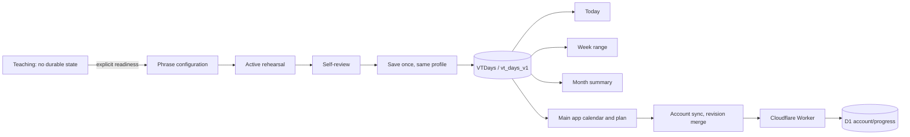

# 50 · Teach before measuring: BreathFlow exemplification and visual pedagogy
Date: 2026-11-22 · Branch: `feature/breathflow-20261122` · Release: **draft, NOT deployed**

## User problem and corrected product hypothesis

The old BreathFlow screen started with text entry, planning, a microphone and self-report. A learner who had never received coaching could finish the whole activity without knowing *what to do with the mouth, tongue, jaw, shoulders or lower ribs*. This is a **learning-design failure**, not a classifier calibration error. A score or count does not teach a movement.

**Hypothesis:** one small, optional-audio and rewindable lesson before the first attempt will make it more likely a novice can describe and enact each checkpoint correctly than a text-only exercise. This remains a hypothesis until observed user sessions. Tests validate software mechanics, not transfer of learning.

Teaching loop: **watch → listen → feel → check → transfer into phrases → reflect**. None of the checkpoints is claimed to be remotely observed. Experienced learners may explicitly skip the lesson instead of wasting time.

## Teaching assets and actual implementation

| Step | Animated example | Sound | Checkpoint / safety |
|---|---|---|---|
| 1 Shoulders, jaw, posture | Figure: ghost raised shoulders vs released shoulder line, head aligned | Visual only | Shoulders and neck soft, no upward effort to take air; do not demand rigid posture |
| 2 Low ribs / belly | Front torso with subtle lateral rib expansion and two hands near the lower ribs | Visual only | Hands can **feel** low-rib/abdominal movement, not prove that the diaphragm was used correctly; do not force maximum inhalation |
| 3 Mouth, tongue, airflow | Simplified side cutaway showing narrow groove for /s/, and relaxed open /a/ variant; toggle | Optional *synthetic* hiss and device TTS for /a/ | No jaw clenching, no single compulsory tongue-tip location: apical and laminal /s/ vary by region |
| 4 Phrase breathing | Timeline: comfortable breath pause then meaningful phrase, animated locator **without seconds** | Optional TTS of original phrases | Do not breathe after every word, hold breath through discomfort, or lose intention to finish a line |

Each stage has **Previous**, **Next**, **Pause / Play animation**, and any applicable **Listen** control. Voice example is available only after a real button press and never uses the microphone. The screen reader receives a text description of the visible diagram. Reduced motion and 44px minimum controls are explicit requirements; illustrations are schematic and emphasize direction, not measured range of motion.

The main practice is **locked on a first visit** until either the learner finishes the four-stage lesson and checks three self-observed qualities, or explicitly chooses "Ya conozco la técnica". The lesson does not mutate the practice ledger. During rehearsal a compact reminder and link back to the demonstration remain accessible.

Technical files: `breathflow.html`, `css/breathflow-teach.css`, `js/breathflow-teach.js`, `js/breathflow.js`. Acceptance tests: `tests/breathflow.spec.js`, fast independent workflow `.github/workflows/breathflow-qa.yml`, standard `quality.yml`.

## Orthogonal implicit state machines and resource ownership

### 1. Didactic progression

**Invariant:** no badge/score for checking boxes or skipping; no claim the browser sensed anatomical position. A novice must have a discoverable path to learn, a returning learner a way out. The lesson stays viewable after Ready.

### 2. Independent animation and speaker lifecycle

`stopSound` cancels speech and closes the instructional AudioContext. It does **not** interfere with the separate `getUserMedia` microphone owned by `js/breathflow.js`. The lesson must never auto-play or send analytics recording audio.

### 3. Cross-screen data and API authority

Current cloud sync remains **main-app-owned**, not invoked by the standalone page. The month and week screens are summaries, not extra competing planners. `docs/49-BREATHFLOW-AND-STATE-MACHINES.md` inventories other state owners: auth, entitlement, record/review, routing, daily/structured sessions, 12-week plan, streak/rest, privacy and DSP.

### 4. Full-site machine risks to revisit

- **Tour → navigation → active take:** a guide may force navigation while a recording continues; route guards and audio ownership must be asserted with a real browser.
- **Daily routine → session set → exercise:** one completed step must not be counted twice when rated; the day ledger and progress history are intentionally different counters.
- **Language switch → scene restart:** the demonstration and its checkpoint copy should redraw without resetting learner progress unexpectedly. The new BreathFlow beta is Spanish-first (bilingual parity **not yet achieved**).
- **Cross-tab/profile sync → plans/history:** revision conflicts require merge and an observable refresh, not a silent replacement of the active account's work.
- **Paywall/admin/analytics events:** tutorial is free; no new entitlement, event, schema migration or external audio upload was introduced.
- **Audio interruption → manual fallback:** microphone detector is independent of lesson audio; Safari foreground, call, headset and permission races still require physical evidence.

## Competitor and user-feedback research (not fabricated fieldwork)

- **Vocal Image** markets short video-based communication lessons, breathing drills, speech exercises, before/after readings and instant feedback: <https://apps.apple.com/us/app/vocal-image-speaking-coach/id1535324205>. A public App Store review complains that instructions were minimal and did not match demos. This is an *individual anecdote*, not a measured defect rate: <https://apps.apple.com/gb/app/vocal-image-speaking-coach/id1535324205?platform=iphone&see-all=reviews>.
- **Simply Sing** foregrounds song-range adjustment, progressive tips and pitch feedback: <https://apps.apple.com/us/app/simply-sing-my-singing-app/id1592900217>. A review requests access to prior lessons and reports cross-device/profile refresh problems: <https://apps.apple.com/pl/app/simply-sing-my-singing-app/id1592900217?platform=iphone&see-all=reviews>. These are user reports, **not independently reproduced**.
- **What the comparisons change here:** teach before scoring; let the learner repeat the demo, switch sound examples, and choose their own text; do not confuse a synthetic demonstration or a microphone heuristic with a certified teacher; validate after each tab switch that the same practice day appears.

No interviews or observational user study were conducted for this change. App Store and Reddit comments can highlight candidate risks, not certify learning gains.

## Scientific checks and teaching trade-offs

- ASHA voice disorders practice portal describes relaxed-shoulder posture, biofeedback and airflow cues: <https://www.asha.org/practice-portal/clinical-topics/voice-disorders/>.
- UMMC clinical voice handout describes hand on chest and belly to become aware of breathing, and relaxed shoulders: <https://umc.edu/Healthcare/ENT/Patient-Handouts/Adult/Speech-Language-Pathology/Voice/Diaphragmatic-Breathing.html>.
- NATS cautions that generic breath-support instructions can lead to over-tensing and that respiratory technique depends on voice use: <https://www.americanacademyofteachersofsinging.org/wp-content/uploads/2020/09/In-Support-of-Fact-Based-Voice-Pedagogy-and-Terminology.pdf>.
- Voice-science evidence supports focusing on breath-pressure coordination rather than maximally filling the lungs; the 2026 review is **narrative**, not a validation of this app: <https://pubmed.ncbi.nlm.nih.gov/42463357/>.
- /s/ articulations differ across dialects and individuals; laminal and apical variants have different tongue-blade/tip configurations. Do not require an identical tip position: <https://pmc.ncbi.nlm.nih.gov/articles/PMC6808342/>.
- MDN recommends pausing/reducing non-essential movement for reduced-motion users: <https://developer.mozilla.org/en-US/docs/Web/API/Web_Animations_API>.

**Costs stated rather than hidden:** the diagram cannot show true 3-D anatomy; sound synthesis is *not* a recorded coach; the four-step walkthrough adds friction; non-persistent lesson completion repeats on refresh; text remains ES-first, screen-reader and real-device signoff are incomplete. The correct longer-term solution is human-teacher audio/video exemplars with permission, transcript, close-up tongue/lips where clinically warranted, and blinded comprehension tests. Do not add externally sourced copyrighted performance audio without rights.

## Four adversarial review rounds (implementation/test review, not all executed)

| Round | Attack | Defence added | Automated oracle | Unverified |
|---|---|---|---|---|
| RT1 scientific/phonetic | Illustrations claim fixed /s/ tip location; hand check proves diaphragm | Clarify variant and subjective tactile cue; do not score anatomy | Lesson caption + SVG description; manual self-check | Specialist phonetics/voice-coach signoff and voice corpus |
| RT2 state/race | Start before learning; skip creates achievement; changing lesson leaves TTS playing; mic prompt returns after Cancel | Guard Start, distinct guide state and mic epoch, explicit Skip, `stopSound` on navigation | Guided lesson flow and late-permission tests | iOS physical interruption and TTS routing |
| RT3 mobile/a11y | Narrow screen clipped illustration, no 44px controls, reduced motion ignores setting, screen reader sees meaningless image | Responsive SVG, text description, pause button, prefers-reduced-motion | 844×390 and keyboard / 360×740 tests | VoiceOver physical device, 200% zoom and user touch |
| RT4 integration/CI/data | New page breaks asset version contract; two copies of a practice day; state diverges after Home→History→Plan | Version manifest and standalone-page rule, shared `VTDays` only, save-once guard, focused CI | Full ledger/browser regression and full repo gate | Real cross-device account sync; final CI/browser evidence |

## Issues ledger and hard release gates

| ID | Actual or likely issue | Status |
|---|---|---|
| TCH-01 | Text-first exercise did not demonstrate physical behavior | Implemented visual teaching; comprehension unvalidated |
| TCH-02 | Single /s/ tongue model would overstate universality | Corrected description; human reviewer outstanding |
| TCH-03 | Animation might be mistaken for a mandated inhalation time | No numeric timing; captions and motion pause |
| TCH-04 | Audio demo might be mistaken for a professional recording | Explicit synthesis/TTS labels; no real human exemplar yet |
| TCH-05 | Tutorial could be skipped without intention | Start guard, deliberate experienced-user bypass |
| TCH-06 | Existing assets test wrongly assumes every page loads common stylesheet | Updated test preserving cross-page version contract |
| TCH-07 | Standalone BreathFlow Save did not reach Done in previous browser CI | Root cause **not yet proved**; diagnostic oracle added; open until green |
| TCH-08 | Real iPhone Safari, screen-reader and cross-device account sync | **BLOCKED** until tested |
| TCH-09 | Full 52-exercise didactic visuals | **NOT IMPLEMENTED**; only the new BreathFlow path taught |
| TCH-10 | Full browser menu × steps × daily/weekly/monthly permutations | **NOT EXHAUSTIVELY VERIFIED**, partial smoke tests present |
| TCH-11 | Playing a teaching sound while breath microphone is listening can award spurious acoustic hints | Reject speaker exemplar while mic is requesting/live; explicit instruction to shut microphone off; targeted test |

**Release conditions:** (1) `npm run test:core`, (2) new fast teaching test workflow and full browser shards all green on same SHA; (3) mobile layout/keyboard, consent and audio off/denied/stale tests; (4) main app account, plan and history parity; (5) real physical iOS Safari session and actual coach audio/visual comprehension review before declaring fully production ready. The branch is a *draft PR* while these gates remain open.

## Teaching transfer and future drift update (2026-11-22, PR #51 follow-up)

A learner checking their own shoulder/rib/jaw boxes had **not** proved they
understood the goal. The fourth animation now contains a short teach-back
decision with two plausible actions: hold a phrase through tension, or pause
and divide it. Choosing the unsafe option gives corrective explanation and
does not unlock the round; the safe option explains why it preserves the
voice and meaning. This is knowledge-transfer feedback, **not** an objective
judgment of the learner's larynx. Experienced users retain explicit Skip.
The negative case is part of the Playwright walkthrough and mutation suite.

A new two-tab browser test attempts to save in tab A while tab B shows
today/week/month; the *visible* B values must update without reload, and
the underlying `VTDays` count must remain exactly one. A second test
advances the same browser from Sunday Nov 22 to Monday Nov 23 and then
December 1; week/month must rebucket without losing or duplicating Nov 22.
This tests time and storage semantics rather than asserting the presence of
a listener. These checks and their explicit failure oracles run in
`.github/workflows/breathflow-qa.yml`; `qa/mutate-breathflow.mjs` plants
independent actual defects in the shipped modules and verifies red tests.
Any failed/blocked gate remains in the release ledger; CI WebKit is not a
physical iPhone or a pedagogy study.

## Round follow-up: returning users, no-save paths and WebKit (2026-11-22)

The old guide forced repeat/Skip on **every reload**, a failure in daily use,
even for someone who had already demonstrated the concept. BreathFlow now
remembers the outcome **per local profile** (`vt_breathflow_lesson_v2_<profile>`,
value `verified` or `skipped`), folds the tutorial for that profile and
shows an explicit "Repasar técnica" control. A direct guide link
(`#flow-coach`) opens it even for returning learners. A different profile
must review or explicitly skip; audio/resources remain separate. This
preference is **local only**, not a synchronized test score or clinical
qualification; denied localStorage means the learner may need to repeat.

A newly executed regression will intentionally refuse `vt_days_v1`
writes. The save must stay in review and say the browser refused persistence;
a reload must **not** show a saved day. Mutation BF-M7 disables that error
guard. Mutation BF-M8 removes remembered tutorial readiness; the returning
user test must reject the change. Thus the tests are sensitive to source
drift rather than checking a checkbox string.

Alongside Chromium, a new `webkit-learning` CI job checks selected
onboarding, cross-tab, date rollover and no-storage cases in desktop WebKit
and emulated Mobile Safari. This is **simulation only**, and is never
evidence that real iPhone hardware or VoiceOver was tested.

A regression against current WebKit and iOS Safari audio can appear even if
AudioContext reports `running`; browser autoplay/output routes and
SpeechSynthesis share audio session state. Relevant external evidence:
<https://developer.mozilla.org/en-US/docs/Web/API/BaseAudioContext/state>,
<https://bugs.webkit.org/show_bug.cgi?id=218815>,
<https://bugs.webkit.org/show_bug.cgi?id=323104>.
Remain manual-only rather than fabricate recorded breath detection or
speaker audibility.

### Source-drift incident: WebKit project allowlist (fixed 2026-11-22)

The first new WebKit job failed with `No tests found`, **before** any
browser assertion. Root cause: `playwright.config.js` maintained per-project
`testMatch` allowlists for four legacy audio specs. Adding a new workflow
was insufficient: both `webkit` and `mobile-safari` silently excluded
`breathflow.spec.js`. The corrected allowlists now include exactly the new
spec in both projects; Firefox and mobile Chrome remain unchanged. A test
that only checks CI exit status without verifying the test count would
mistakenly call this a product defect or skip the intended Safari coverage.

The new run must show **nonzero WebKit and mobile-safari tests actually
executed**, then inspect failures individually. On a future rename, update
both the workflow and the Playwright project allowlist and confirm
`--list` names the expected tests. Never weaken the oracle by dropping the
file or running just Chromium instead.

### Prevent future silent WebKit coverage loss

The project selector is now under a **runtime Node contract**:
`tests/node/playwright-projects.test.mjs` requires both `webkit`
and `mobile-safari` to select `breathflow.spec.js`, while ensuring
heavy headed sweeps are excluded. Mutation BF-M9 temporarily removes
BreathFlow from desktop WebKit's selector and must make this test fail.
The test runs in `npm run test:core` as well as the focused workflow.
This does not imply a speaker test or true iOS physical compatibility.

## Follow-up QA: observable UI vs storage, mutant oracle (2026-11-22)

**Finding TCH-12 / root cause.** The BF-M9 source-drift mutant correctly caused the Node
WebKit-selection contract to fail, but the mutation harness judged it *alive*.
The intended error message contained the diagnostic words `No tests found`;
a broad `log.includes("No tests found")` check rejected the actual assertion.
At commit `841c3a3`, the no-tests guard now applies only to Playwright browser
mutants. A Node mutant still needs a named, failing assertion and no
syntax error. Correct and incorrect log examples were checked before the patch.
A passing same-SHA CI run is still required.

**Finding TCH-13 / root cause.** The shared-ledger navigation spec clicked main
History, Plan and Home, but checked only `VTDays.read()` afterward. A broken
renderer could pass because the underlying state was unchanged. The enhanced
spec now checks the **visible** History calendar count (one day), activates
the existing 12-week Plan in the same day, checks its **visible** day count,
and returns Home without losing the ledger. BF-M10 hides the rendered History
calendar; BF-M11 feeds a false zero into Plan. Both must turn that same
behavioral spec red. This narrows an important false-green route; it does
**not** exhaustively test every main-app tab at every lesson step or a cloud
account on a second physical device.

**Red-team evidence and limits.**

1. Falsifiability: BF-M9 expected-assertion/fatal-runner ambiguity reproduced
   in Actions log `45087132974` and fixed in code; full rerun pending.
2. UI/store divergence: main navigation spec previously used a shared-store
   self-oracle; independent rendered-data assertions and two targeted source
   mutations added; CI pending.
3. Accessibility/mobility: existing CI WebKit and emulated iPhone teaching
   tests passed at an earlier SHA, but physical iPhone/VoiceOver/200% zoom
   remain unverified on the current candidate.
4. Integration and release: five open PRs (#41, #47, #48, #50, #51).
   #41/#47/#50 reported non-mergeable, and #48/#51 overlap broad integration
   surfaces. Do not force-merge, conflate synthetic personas with interviewed
   users, or deploy BreathFlow on the strength of an older commit.

**Future-drift probes:** alter the real History renderer, active-plan counter,
WebKit test-match pattern, storage revision, clock boundary or permission
epoch in isolation; each must produce a specific, explainable failing
observable rather than an unrelated runner crash. Keep competing PR heads,
their CI SHAs, and the production GitHub Pages commit separate in the release
ledger.

## 2026-11-22 — Didactic migration after adding phrase-boundary teach-back

The phrase-boundary comparison is a substantive new learning outcome, not merely
a visual restyling. To avoid treating a prior completion as evidence that the
learner saw the updated explanation, completion markers now use
`vt_breathflow_lesson_v2_<profile>`. An earlier
`vt_breathflow_lesson_v1_<profile>` marker does **not** unlock the new lesson
automatically. Returning experienced users can still choose the explicit
`Ya conozco la técnica` fast path. This introduces one extra review/skip
after upgrading, rather than misrepresenting historical progress.
`legacy v1 completion does not bypass new phrase-boundary teaching` is
the observable browser test; BF-M14 deliberately downgrades the key and
must make that test fail. A verified v2 decision shows understanding of the
choice, **not** verified anatomical or muscular technique.
