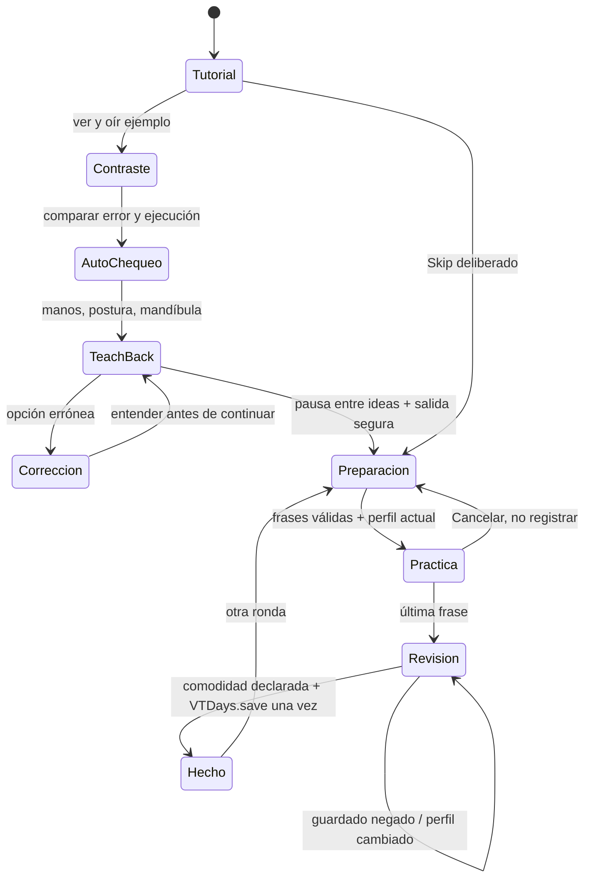
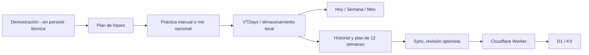

# 51 · Progresión de técnica vocal, investigación y pruebas de transferencia
Estado: propuesta de currículo + un contraste implementado en el borrador PR #51 (no desplegado).
Fecha de trabajo: 2026-11-22. No equivale a evaluación clínica ni a aprendizaje humano validado.

## Decisión preejecución
**Alternativa A — puntuar más alto por segundos, volumen o respiraciones automáticas:** fácil de automatizar, pero premia sostener aire o empujar la voz sin comprobar comodidad ni fraseo; rechazada.
**Alternativa B — solo instrucciones y casillas:** rápida y accesible, pero permite completar sin entender en qué punto respirar; insuficiente por sí sola.
**Alternativa C — ejemplo, contraejemplo, autoobservación, decisión y transferencia:** elegida para BreathFlow. Costes explícitos: tutorial más largo, muestra /sss/ sintética y TTS no humanas, gráficos anatómicos esquemáticos, capacidad de evaluar la respuesta conceptual pero no la coordinación real. Retener 'Ya conozco la técnica' y opción de repasar.

La instrucción observada del profesor: respiración natural en puntos relevantes de la frase, manteniendo intención, potencia expresiva y comodidad; **no** una inhalación mecánica tras cada palabra. Más aire no implica necesariamente más proyección.

## Progresión propuesta (no declarar 'implementado' sin código y prueba independiente)

| Etapa | Habilidad y ejercicio | Demostración y checkpoints | Evidencia de comprensión / transferencia | Situación |
|---|---|---|---|---|
| 0 | Seguridad, postura sin rigidez | Mostrar hombros relajados frente a hombros elevados; mirar y sentir cuello/jaw cómodos | Señala cuándo parar y cómo simplificar | Parcial en BreathFlow |
| 1 | Respiraciones entre ideas | Contraste visual de cada palabra vs frase con pausa; manos en costillas bajas opcionales, sin empujar abdomen | Marca pausa útil y sabe dividir frase ante incomodidad | Implementación PR #51, validación humana pendiente |
| 2 | Flujo de aire vs fonación | Comparar /s/ sin voz y /a/ con voz; variaciones de /s/ por dialecto | No confunde duración del siseo con calidad vocal | Solo visual + sonido /sss/ sintético |
| 3 | SOVT suave | Trino de labios, /m/, fonación con pajilla como alternativas; referencia con maestro autorizado | Expresa sensación y traslada una frase cómoda al habla/canto | Contenido y medios pendientes |
| 4 | Inicio fonatorio y resonancia | Comparar entradas abruptas, aspiradas y coordinadas, evitando receta anatómica universal | Inicia frase sin esfuerzo percibido excesivo | Pendiente |
| 5 | Vocales, lengua, mandíbula y articulación | Primeros planos y SVG /a i u/ y consonantes, dialectos; movilidad sin apretar | Texto inteligible manteniendo comodidad | Solo /s/ y /a/ parciales |
| 6 | Afinación y ritmo | Referencia humana, control de F0 con incertidumbre, pausa según métrica | Repite notas y explica limitaciones de puntuación acústica | DSP existente; tutoría no homologada |
| 7 | Registro/pasaje, matices y rango cómodo | Sirenas pequeñas, dinámica suave, cambio gradual de registros | No confunde subir dB con mejor apoyo; detiene al sentir tensión | Revisión pedagógica pendiente |
| 8 | Fraseo de canción y presencia escénica | Demostración profesional con marcas de pausa, mirada y narración | Traslada decisión a una estrofa nueva y siente comodidad | Pendiente |
| 9 | Recuperación y autorregulación | Pausas, revisión y señales para pedir ayuda profesional | Elige bajar dificultad o parar al sentir dolor/ronquera | Parcial |

La secuencia es **adaptable**, no un prerrequisito médico ni una clasificación universal de todas las voces. No hacer progresión por número de días, altura máxima, sostenimiento de nota o intensidad SPL de un micrófono no calibrado. Para ruido/vibrato/timbre, exigir muestras etiquetadas y revisión docente antes de inferir mejora.

## Diseño diario, semanal y mensual sin estados duplicados
- Diario: una demostración/revisión breve, intentos cortos con alternativa sin micrófono, reflexión de comodidad. Solo `VTDays` acredita la actividad una vez por guardado.
- Semanal: un objetivo en el **plan ya existente** de 12 semanas; revisar un fragmento diferente con las mismas decisiones de fraseo, sin escribir otro plan.
- Mensual: resumir días en `VTDays`, distinguir frecuencia de habilidad real; decidir con el usuario el siguiente foco. No introducir otra fuente de verdad.

Propuesta orientativa de 12 semanas: 1–2 respiración y fraseo; 3–4 SOVT/aire-sonido; 5–6 inicios/articulación; 7–8 afinación/ritmo; 9–10 registro y matices; 11–12 canción y presencia. No sustituir objetivos individuales ni fuerza una secuencia fija.

## Máquinas de estado y arquitectura

Máquinas ortogonales: lección/revisión; mic apagado/solicitando/vivo/interrumpido; audio de muestra apagado/sonando/cancelado; grabación/MediaRecorder finalizando; navegación; perfil; cuenta/autenticación; plan de semanas; calendario/descanso; sincronización; pagos/entitlements. Cada evento asíncrono tiene dueño, generación o revisión, cancelación, regla de reintento y diagnóstico. Nunca permitir que una reproducción TTS se contabilice como respiración del usuario ni que una promesa tardía reactive el micrófono.

## Pruebas independientes, red-team por rondas
| Ronda | Fallo que se debe reproducir | Oráculo y defensa | Estado de evidencia |
|---|---|---|---|
| 1 Didáctica | Completa tras casillas y respuesta de comodidad sin entender dónde respirar | Elige "palabra por palabra" y debe permanecer bloqueado; BF-M12 elimina la guarda y vuelve roja la prueba | Código y prueba incluidos; CI final pendiente |
| 2 Técnica/ciencia | /sss/ ruido/altavoz/voz sintética mal clasificados como inspiración | Sin puntuación diagnóstica, silenciar ejemplo mientras mic está activo, registrar incertidumbre | Software parcialmente probado; corpus real sin validar |
| 3 Concurrencia | Permiso tardío, doble guardado, cambio de perfil, dos pestañas, medianoche | Epoch/cierre + VTDays; pruebas de perfiles y valores **visibles** Historia/Plan; BF-M10/BF-M11 | Simulaciones CI, sincronización de dos dispositivos reales abierta |
| 4 Accesibilidad/orquestación | Zoom 200 %, VoiceOver, iPhone Safari, render obsoleto, cambio de idioma | Grilla apilable, texto accesible, botones 44 px, CSS reduce-motion; revisar output real tras cada click | Emulador WebKit sí; iPhone/AT humano no |

**Futuro drift:** cambiar un selector de JS, un ID del DOM, un nivel de entrenamiento, un prefijo de almacenamiento, `testMatch` de WebKit o idioma, o servir JS con `?v` obsoleto: debe fallar un contrato específico con evidencia observable. Error de test runner por falta de tests, cancelación o timeout nunca equivale a mutante muerto. `qa/breathflow-oracle.mjs` contiene esa distinción.

## Jerarquía de evidencia y límites de investigación
- Titze (2006), *Voice training and therapy with a semi-occluded vocal tract*, PMID 16671856: https://pubmed.ncbi.nlm.nih.gov/16671856/ — racional fisiológico, no promesa de mejora universal o duradera.
- ASHA, Voice Disorders Practice Portal: https://www.asha.org/practice-portal/clinical-topics/voice-disorders/ — guía clínica que no se puede trasladar sin más a todos los cantantes sanos.
- American Academy of Teachers of Singing, terminología y pedagogía basada en evidencia: https://www.americanacademyofteachersofsinging.org/wp-content/uploads/2020/09/In-Support-of-Fact-Based-Voice-Pedagogy-and-Terminology.pdf
- NIDCD, higiene vocal: https://www.nidcd.nih.gov/health/taking-care-your-voice
- WCAG 2.2, acceso por teclado, zoom y controles: https://www.w3.org/TR/WCAG22/
- MDN/WebKit, permiso y audio suspendido: https://developer.mozilla.org/en-US/docs/Web/API/MediaDevices/getUserMedia

Competidores: Yousician, Simply Sing, Vocal Image y aplicaciones de afinación priorizan distintos tipos de feedback. Esto da **hipótesis**, no una encuesta representativa ni eficacia. Comprobar con entrevistas/observación ciega de cantantes nuevos y docente; las reseñas anecdóticas son investigación exploratoria, no resultados de experimentos.

## Trade-offs, puertas de publicación y ubicación operativa
Repositorio y docs: github.com/PillB/vocal-singing-training, `docs/`, `AGENTS.md`, `agent.md`, `CLAUDE.md`; web en GitHub Pages desde `main`; Worker en `workers/entitlements/`, Cloudflare D1/KV; progreso localStorage e IndexedDB; GitHub Actions CI. Sin PostgreSQL dedicado en este módulo: no crear pool. Outbox solo ante efectos secundarios transaccionales (pagos/notificaciones) y con consumidor idempotente; sync de progreso necesita resolución de conflictos por revisión, no last-write-wins ciego.

No fusionar/desplegar por un verde anterior a la última versión. Se requiere CI completo y específico del SHA final, Safari físico con cambios de dispositivo y permisos, VoiceOver/zoom real, revisión de docente, usuarios novatos y sincronización cruzada. Una decisión correcta en pantalla demuestra comprensión declarativa, **no** técnica vocal correcta.

## Independent review repair — 2026-11-23

Two reproduced blockers repaired on a separate PR targeting this draft:

- Guide playback is stopped synchronously before optional microphone permission
  is requested. The opposite-order guard already existed; both orders need a
  regression and mutation.
- A refused day write retains the original round receipt. Retry flushes only
  that profile's pending day value; it does not call VTDays.record a second
  time. Unrelated unsaved settings/lesson keys do not decide the day's status.
  Record once, fail/retry twice, recover and reload must preserve n1 and the
  original seconds. Profiles cannot cross the pending round's owner check.

The real-storage Node regression passes. Chromium/WebKit acceptance and mutants
must run on the repaired draft head; local macOS browser launch remains blocked.
These repairs do not close physical iOS/acoustic, bilingual, instructor/novice or
real sync gates. Before merging to main, define bf-breathflow as a supplemental
breath/phrasing activity in the skill-area policy and test it without pretending
it is one of the52 catalogue exercises. Do not silently drop it from area counts.

Retry merges the latest persisted day bag via VTDays.merge before flushing,
so a newer tab’s distinct days/exercise IDs are retained. This inherits the
existing same-day max(n,sec) union policy; it does not add concurrent counts
and cannot promise exact take totals across simultaneous offline devices.
