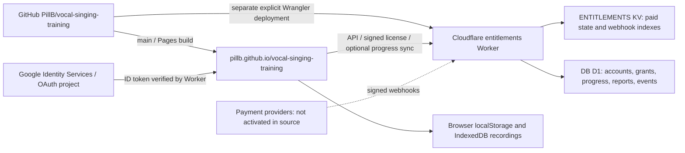

# Deployment, accounts and recovery map

Last evidence review: **2026-11-25**. Recheck after every deployment, account
change, key rotation, domain change or provider activation. A configured client
ID, repository author or reachable URL does not identify a service's owner.

## Where the project runs

**These are separate deployments.** A successful Pages build does not update
the Worker. A Cloudflare Workers & Pages screen has Workers and Pages projects;
the current backend replica needs a Worker, KV and D1. A future frontend
migration is a separate release, tracked by subscription PR54.

| Service / resource | Location and purpose | Evidence / current confidence | Operator record |
| --- | --- | --- | --- |
| GitHub repository | [PillB/vocal-singing-training](https://github.com/PillB/vocal-singing-training) | Verified repository; `main` is the deployment source. Author email is not proof of the account's current primary email. | Private inventory: GitHub owner, recovery and repository permissions. |
| GitHub Pages | [Live app](https://pillb.github.io/vocal-singing-training/), guide, admin and QA pages | Pages API verified legacy deployment from `main:/`, built, HTTPS enforced and CNAME null. Check deployment SHA separately from PR CI. | GitHub → Settings → Pages; successful build/deployment run URL and SHA. |
| Existing production Worker | `vocal-studio-entitlements.vocalstudio-pe.workers.dev` | Configured in `js/billing-config.js` and CSP. Historical live health confirms service existence. **Source account owner is unresolved.** | Private inventory: source account ID, membership, versions, bindings and signing-key backup reference. |
| Selected Cloudflare account | Authenticated login record is private | Wrangler verified the selected login on 2026-11-25. Its subdomain is `pablo-illescas-buendia`. Successful complete API listings found **zero Workers, KV namespaces, D1 databases and Pages projects** before replication. This does not prove the source Worker is absent from other accounts. | `.deployment-local/cloudflare.json`; `docs/SERVICE-ACCOUNTS.local.md`. |
| Replica Worker | [Replica health](https://vocal-studio-entitlements.pablo-illescas-buendia.workers.dev/v1/health?probe=1) | Created from main `43374b7`; version `e05e4a17-53c0-430e-82d5-93d08a20d61d`. D1/KV/writes probes passed; fresh signing key, Google configured, trial7, reports on, events off, payment rails off. **Frontend still uses the original Worker.** | Destination account/bindings, source SHA, version, health and JWKS fingerprint. |
| KV `ENTITLEMENTS` | Worker binding, not a GitHub file | Paid entitlements, bearer-license indexes, webhook deduplication and health flags. Checked-in IDs are placeholders. Resource titles are not proof of ownership. | Exact namespace ID and preview ID in private deployment record; preview must differ. |
| D1 `DB` | `vocal-studio-accounts` database | Accounts, identities, hashed sessions, trials/grants, progress revisions, reports and anonymous events. Schema is in `workers/entitlements/src/schema.js`. | Exact database ID, account, backup/export reference and restore test. |
| Google Cloud OAuth | Project number prefix `636631700114`; public web client in `wrangler.toml` | Public client ID is configured; owner email/project ID are **not established** by the client ID. Verify IAM and OAuth Clients in Cloud Console. | Private inventory: project ID/number, owner members, consent support email and authorized origins. |
| Cloudflare secrets | Worker Settings → Variables and Secrets | Values cannot be recovered by listing secret names. Never rotate a signing key because a lookup failed. | Secret **names and password-manager item references**, never values. |
| Health alarm / CI | `.github/workflows/health-ping.yml`, `quality.yml`, `live-pages.yml` | Repository variables API returned **zero variables**, so the alarm is not armed. Release verification checks deployed HTML/all versioned assets, then live Playwright. These do not replace real microphone/device checks. | Variables, notification recipients and latest successful alert drill/run. |
| Browser storage | `pillb.github.io` origin | `vt_*` localStorage keys; profile-scoped progress/settings/days; `vt_account_session_v1` bearer session; IndexedDB `vt_recordings_db` / `recordings`. Recordings remain local. Other Pages projects on the same origin share storage quota. | Export user data before clearing storage or changing origin. Browser exports are not server backups. |
| Local configuration | This checkout and the historical Documents/GitHub checkout | Historical checkout has uncommitted resource IDs. Do not overwrite it with pull/autostash or publish its local TOML. Temporary `/tmp` artifacts are **not durable backups**. | Private inventory lists exact paths and their roles; use durable encrypted backup/password manager for recovery. |
| Claude / Codex / Composio | Development tools and historical sessions | Git authors `Claude` / `claude[bot]` identify tooling, not hosting ownership. Composio GitHub connection is deployment tooling, not the backend. | Login/recovery refs belong in private inventory, separate from production credentials. |

## Supported providers are not proof of existing accounts

| Integration | Code and source configuration | What is still unknown |
| --- | --- | --- |
| Creem | Intended international checkout rail; both checkout links and product IDs empty. | Merchant approval, owner email, products, webhook secret and payout account. |
| Mercado Pago Perú | Intended Peru/LATAM rail; links and plan IDs empty. | Merchant account, owner email, plan, webhook/access token and bank settlement. |
| Stripe | Worker supports signed events; retained fallback, no selected market or checkout links. | Whether any merchant account exists. Do not infer one from supported code. |
| Resend / Brevo / MailerSend | Supported alternatives; `EMAIL_PROVIDER` and `EMAIL_FROM` empty. | Account and verified sender/domain; no email provider is activated by source config. |
| Google AdSense / affiliates | `adsEnabled=false`; publisher/slot IDs and affiliate URLs empty. | Approved publisher or partner accounts; ads are not configured. |
| Polar / Paddle / Gumroad / Lemon Squeezy | Research alternatives in operator/payment docs. | No deployment/account evidence found. |
| Culqi / Openpay / Niubiz / Yape / Payoneer / banks / SUNAT / Indecopi | Business, regulatory or fallback discussion in the Peru runbook. | These mentions do not establish project accounts, contracts or registrations. |
| Historical-score archives | LOC, Rochester and Johns Hopkins links in the song library. | External references, not storage owned by this project; monitor edition links without substituting copyrighted arrangements. |

Pending [PR54](https://github.com/PillB/vocal-singing-training/pull/54) additionally
researches Shopify, Dodo, PayPal and Patreon and proposes Cloudflare Pages on
an owned domain for future subscriptions. Its87 changed files were checked for
account/email clues: checkout links/product IDs remain empty, API checkout is
off, and no new verified operator email was found. It proposes an application
to Paddle; that is not evidence of an approved merchant account. A Cloudflare
Pages project, domain registration and branded support mailbox remain
**unprovisioned/unverified**. GitHub's [Pages terms](https://docs.github.com/en/pages/getting-started-with-github-pages/github-pages-limits)
restrict sites primarily facilitating commercial transactions/SaaS; keep
payment activation and any frontend migration behind that release's review.

## Email evidence and private record

The selected Gmail is verified by Wrangler identity. The historical login clue
`pillescasdies` now has a verified Gmail address on the **Composio development
account**, recorded privately; this does not prove Cloudflare ownership. The examples
`ana.perez@gmail.com`, `anaperez@gmail.com`, `first.admin@gmail.com`,
`second.admin@gmail.com`, `hola@tudominio.com` and the test-suite addresses are
documentation/fixture examples, not discovered operators. Bot noreply addresses
are author metadata. No verified support/refund mailbox was found.

The complete private address-to-service evidence list is
`docs/SERVICE-ACCOUNTS.local.md` (ignored by git), with binding IDs and deployment
targets under `.deployment-local/` (also ignored). It contains no passwords,
tokens, signing private keys or bearer licenses. **Ignored files are not shared
or backed up by git:** keep a durable encrypted backup, record its location in
the private inventory, and give a recovery operator access. Never claim a
password-manager backup exists until an actual item/reference has been saved.

Each private service entry needs: service and environment; login email;
account/project/resource ID; owner and recovery administrator; URL; data held;
credential-name → password-manager reference; last verified date/method;
deployment source SHA and live version; backup/restore reference; renewal or
billing responsibility; unresolved gaps. Unknown is a valid value; inference is
not verification.

## Deploy current main without overwriting private configuration

Use `./wrangler.sh --help`. The wrapper fetches **current remote main**, archives
that exact SHA into a temporary directory and combines its versioned policy
with **only** the private account/resource fields. It does not pull, autostash,
switch branches, copy an old full config over main or provision resources.
Python 3.11+ parses TOML; Node 22+, git, tar and pinned Wrangler 4.144.0 are needed.

1. Sign in with the login in the private record (`npx wrangler@4.144.0 login`).
2. Populate `.deployment-local/cloudflare.json` from the private inventory.
3. Run `./wrangler.sh --plan`: freshly fetched SHA, identity/account, actual
   account subdomain, namespace/database membership, signing-secret presence, matching JWKS,
   single 100% rollback version and Worker build must all pass.
4. Run `./wrangler.sh --deploy`. It repeats preflight, checks main did not move,
   deploys with anonymous events off, then requires real D1/KV read probes and
   unchanged signing identity. Failure stops with a private rollback receipt;
   it does not blindly repeat a write or automatically undo database changes.
5. Validate authenticated admin/progress/trial flows and physical-device audio
   separately. `--enable-events` is an explicit analytics opt-in, not a claim
   that a human inspected the admin page.
6. Update this map and the private record with the source SHA, before/after
   version, probe and browser run URLs. A new destination needs a separately
   reviewed frontend URL/JWK change and cache-version bump.

The wrapper rejects inherited Wrangler environment/name/API overrides and new
unsupported main resource shapes. It records the before and actual after
version IDs and verifies the new version's source-SHA message annotation.
If another deployment changes the rollback target during preflight, it stops.
This is optimistic concurrency: Cloudflare does not provide an atomic lock
against a different operator deploying between the final check and the write.
Use one operator at a time and inspect version/receipt evidence on any mismatch.
An interrupted process can leave `.deployment-local/deploy.lock`; check live
versions and the receipt before removing a stale lock. For an explicit version
rollback, use the receipt's account ID and previous version with
`CLOUDFLARE_ACCOUNT_ID=<account> npx wrangler@4.144.0 rollback <version> --name vocal-studio-entitlements`
from the repository root. A rollback does not restore D1/KV state.

After Pages deploys, `Deployed Pages verification` checks the deployed index
and every stamped asset against the checked-out release, then runs live
Playwright. It can also be dispatched manually after a known successful Pages
deployment. Stale HTML, same-version changed assets and HTTP404 controls fail;
there is no automatic retry that could conceal an incorrect deployment.

## Retrospective: why ownership and release status were lost

Historical Claude output records a successful `vocalstudio-pe` redeploy on
2026-09-24 and reused storage/key, but no reliable account-owner record. Public
git author addresses, OAuth client IDs and Worker hostnames were subsequently
treated as ownership clues. Meanwhile Pages updated automatically and the
Worker stayed on old policy. The selected account's successful empty inventory
finally distinguished **wrong account** from **no existing service**.

The old setup pipeline also conflated failed secret listing with key absence;
it now requires successful, well-formed top-level array inventory. An error
object containing nested `[]` is rejected, not interpreted as an empty account.
The old redeploy helper checked a branch name rather than current remote main,
and could probe a URL different from its deployment target. The wrapper binds
the URL to the authenticated account, checks real bindings and exact source,
and preserves private ownership/version evidence on each run.

For first creation, inventory the destination first and use scoped resource
names. Provision explicitly; keep a replacement on its separate URL. Without
source access, **fresh accounts/storage/keys are a replacement, not a migration**.
Do not switch production or claim existing grants, licenses or progress moved.

## Decision record, regression and drift review

| Alternative / failure | Decision and measurable test | Trade-off |
| --- | --- | --- |
| Pull/autostash the operator checkout vs isolated fresh-main snapshot | Archive fetched SHA; newer main policy wins while private binding overrides remain local. Wrong/stale main and unknown override negative fixtures must fail. | Needs network and temporary disk; local unpublished changes are deliberately absent from the deployment. |
| Automatically recreate missing resources vs fail on ambiguous API failure | Authenticate and inventory first; list failure is not empty inventory. No key generation on secret-list failure. | First creation needs an explicit provisioning operation. |
| Enable all features after superficial health vs real binding reads | Require `?probe=1` DB/KV `ok`, correct origin/policy and same JWKS. Missing probe, HTTP503, changed key and wrong-account fixtures fail. | Reads cannot prove writes, payment correctness or real user/device behavior. |
| One public inventory vs split operational records | Public topology and gaps; private ownership/config and password-manager references. | Private records require their own backup and maintenance; no personal admin addresses in public git. |

Red-team rounds: malformed IDs/unknown overrides; stale-main and account races;
operator recovery and missing rollback; signing/trial/data continuity;
integration/privacy/credential leakage. No UI or scientific scoring changed;
aesthetic/pose review is not applicable to these operator documents. New remote
binding shapes, secret-list schema changes, removed services, expired login,
renamed resources and missing backups must stop or be marked **unverified**,
never silently treated as successful migration.

Primary references: [Wrangler configuration/source of truth](https://developers.cloudflare.com/workers/wrangler/configuration/),
[deployment and rollback commands](https://developers.cloudflare.com/workers/wrangler/commands/workers/),
[identity commands](https://developers.cloudflare.com/workers/wrangler/commands/general/),
[secret preservation](https://developers.cloudflare.com/workers/configuration/secrets/),
[D1 import/export](https://developers.cloudflare.com/d1/best-practices/import-export-data/).

## Verified implementation results

The guarded wrapper was exercised against the actual replica: it fetched main
`43374b7fb748cd56f6eb42356e635be596f94a4b`, preserved the signing key, deployed
version `80f192ee-58ca-4f72-9b32-281a77618c20`, verified its source annotation,
and passed D1/KV/JWKS checks with events off. The previous version and private
receipt were copied into the canonical workspace's ignored directory.

Final local core: **1359 passed,0 failed,2 existing billing TODOs**. All nine
ops mutants were killed and restored. Independent QA reproduced and then
retested wrong-account URL, environment overrides, secret-inventory errors,
changed/unchanged/concurrent versions and failed final analytics verification.
Hosted CI and the post-merge live Pages Playwright run remain separate evidence;
these results do not establish physical-device, payer, human-admin or migrated
data validation.
