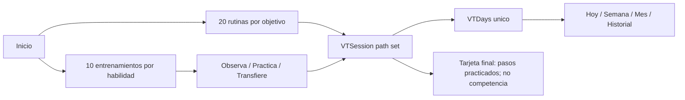

# 57 — Entrenamiento por habilidad (sets focalizados)

Fecha 2026-11-27. Implementación educativa en rama apilada sobre PR #64; no es diagnóstico ni terapia. Leer docs/47-SESSION-SETS.md y docs/56-BREATHFLOW-EVIDENCE-BASED-DESIGN.md.

## Decisión y compensaciones

- Rechazada ruta A: añadir todos los contenidos a la lista de rutinas por objetivo, porque la persona que necesita trabajar una dificultad concreta no recibe una secuencia identificable ni un criterio de transferencia.
- Rechazada ruta B: segundo motor y segundo ledger de habilidad; duplicaría sesión, perfiles, día/semana/mes y crearía carrera de permisos, así como premios por volumen/tiempo sin evidencia.
- Elegida ruta C: botón vecino **Entrenar una habilidad**, mismo selector, VTSession path set, VTDays y tarjeta de pasos. 10 sets (5 canto y 5 habla) con guion Observa → Practica → Transfiere → Si incomoda, textos es/en y dosis de UX acotadas.
- Trade-offs: más contenido requiere filtrado y lectura; los ejercicios existentes no tienen demos profesionales específicas; los tiempos son iniciales y acortables, no protocolos terapéuticos; sin nueva puntuación de dominio ni medalla automática implica menos gratificación pero reduce incentivos a forzar la voz.

## Evidencia verificada

| Código | Estudio/guía | Resultado trasladable y límite |
|---|---|---|
| RMT26 | https://pubmed.ncbi.nlm.nih.gov/42185121/ | Metaanálisis 7 estudios: fuerza/capacidad puede mejorar; rendimiento musical inconcluyente. Respiración entre ideas, **no** entrenar apnea máxima. |
| SOVT25 | https://pubmed.ncbi.nlm.nih.gov/41058356/ | Revisión 20 estudios en cantantes: mejoras heterogéneas y sin dosis universal. |
| SOVT26 | https://pubmed.ncbi.nlm.nih.gov/41896048/ | Ensayo 45 coristas en 4 semanas: algunos resultados favorecieron tubo en agua; no extrapolar a todos. |
| MAP26 | https://pubmed.ncbi.nlm.nih.gov/42982685/ | Mapeo 244 estudios: distinguir diseño, constructo, resultado y horizonte; contar estudios no valida eficacia. |
| ASHA | https://www.asha.org/practice-portal/clinical-topics/voice-disorders/ | Progresión de voz resonante y SOVT principalmente clínica; aplicación a cantantes sanos no automática. |
| MOTOR26 | https://pmc.ncbi.nlm.nih.gov/articles/PMC13152083/ | Hipótesis de aprendizaje motor: variar contextos y reducir el feedback para transferencia. |
| NIDCD | https://www.nidcd.nih.gov/health/taking-care-your-voice | Parar si la voz está ronca/cansada, descansar; no reemplaza médico. |
| GAME24 | https://link.springer.com/article/10.1007/s11423-023-10337-7 | Metaanálisis educativo: impacto motivacional pequeño y casi nulo en competencia percibida; preferir autonomía y no castigar pausas. |

## 10 sets nuevos con catálogo existente

| ID | Técnica | Ejercicios y segundos | Decisión de seguridad |
|---|---|---|---|
| s-skill-breath | Aire entre frases | s18 60 → s8 120 → s3 180 | Si necesitas aire, dividir frase; no prolongar /s/ por score. |
| s-skill-onset | Iniciar sin apretar | s7 90 → s12 120 → s20 120 → s3 90 | Sin ataque duro o esfuerzo. |
| s-skill-sovt | Sonido cómodo | s4 90 → s6 120 → s3 90 | Hum alternativo a pajita; cero presión forzada. |
| s-skill-pitch | Centro afinación | s9 150 → s10 120 → s13 150 → s3 90 | Primero referencia, luego sin gráfico. |
| s-skill-phrasing | Fraseo y legato | s14 150 → s20 90 → s3 180 | Texto original y pausa cómoda. |
| v-skill-breath | Aire al hablar | s18 60 → v10 120 → v23 150 | Pausas por sentido. |
| v-skill-clarity | Dicción | v14 120 → v23 150 → v10 90 | Claridad para oyente, no solo velocidad. |
| v-skill-ease | Voz cómoda | s7 60 → v21 210 → v23 120 | No practicar con ronquera/dolor. |
| v-skill-expression | Intención | v12 120 → v14 120 → v19 120 | No perseguir volumen o carisma numérico. |
| v-skill-recovery | Descanso | s17 90 → v22 600 | Si hay ronquera, solo descanso; no terapia automática. |

Los pasos usan solo IDs existentes y timers inferiores a su timerDefaultSec. El grado lim o trad califica evidencia de componentes, no el aprendizaje personal. La ficha incluye una tarea nueva como prueba de transferencia, pero la app no verifica su ejecución anatómica.

## Máquina de estados y gamificación

El almacenamiento no tiene nuevo skill score ni otra tabla. El step trail actual muestra progreso de la sesión, no dominio. VTPath.noteSet no se llama en estos sets focalizados: no atribuir logros clínicos. Animaciones reales específicas por habilidad y voz profesional licenciada están pendientes; se conservan los gráficos y sonidos de ejercicios existentes.

## Cinco rondas de red-team falsables

1. Ciencia: plantar 'guaranteed improvement' o falta de fallback; el validador debe ponerse rojo. No alargar expiración por rendimiento.
2. Estado: mutar el resolver para ignorar los SKILL_SETS; el test debe mostrar que deja de poder iniciar un set real, sin duplicar VTSession.
3. Integración: completar skill debe no crear logros de set genérico; mutar el guard de VTPath.noteSet debe poner rojo el test.
4. Accesibilidad: emular 320 px, es/en, selección y filtro; el botón y la hoja deben conservar 44 px y no causar scroll horizontal. Safari real/VoiceOver aún pendientes.
5. Deriva: borrar ID del catálogo, asignar segundos superiores, quitar traducción o evidencias; cada contraprueba debe indicar ID y motivo.

Pruebas: npm run lint; npm run test:core; node --test tests/node/skill-sets.test.mjs; npx playwright test tests/skill-sets.spec.js --project=chromium; pruebas de WebKit y dispositivos físicos por separado. Estas ejecuciones deben identificarse por SHA, no por listas de archivos presentes.

## Validación humana futura

Piloto de usabilidad 5–8 personas para identificar confusión, no demostrar eficacia. En una evaluación comparativa posterior, tarea nueva y profesor evaluador ciego a condición en lo posible, autoinforme de comodidad y medidas de retención predefinidas. No inferir 'déficit de apoyo' ni enfermedad desde micrófono o una sola autoevaluación.

Returning-visit discovery and Pro/trial rollout policy: see
[docs/61-SKILL-DISCOVERY-AND-ACCESS.md](61-SKILL-DISCOVERY-AND-ACCESS.md).
Launch preview does not consume the opt-in trial. Runtime teaching follows the
actual current sequence; persisted older sequences retain their original
exercise instructions rather than receiving incompatible new skill cues.
