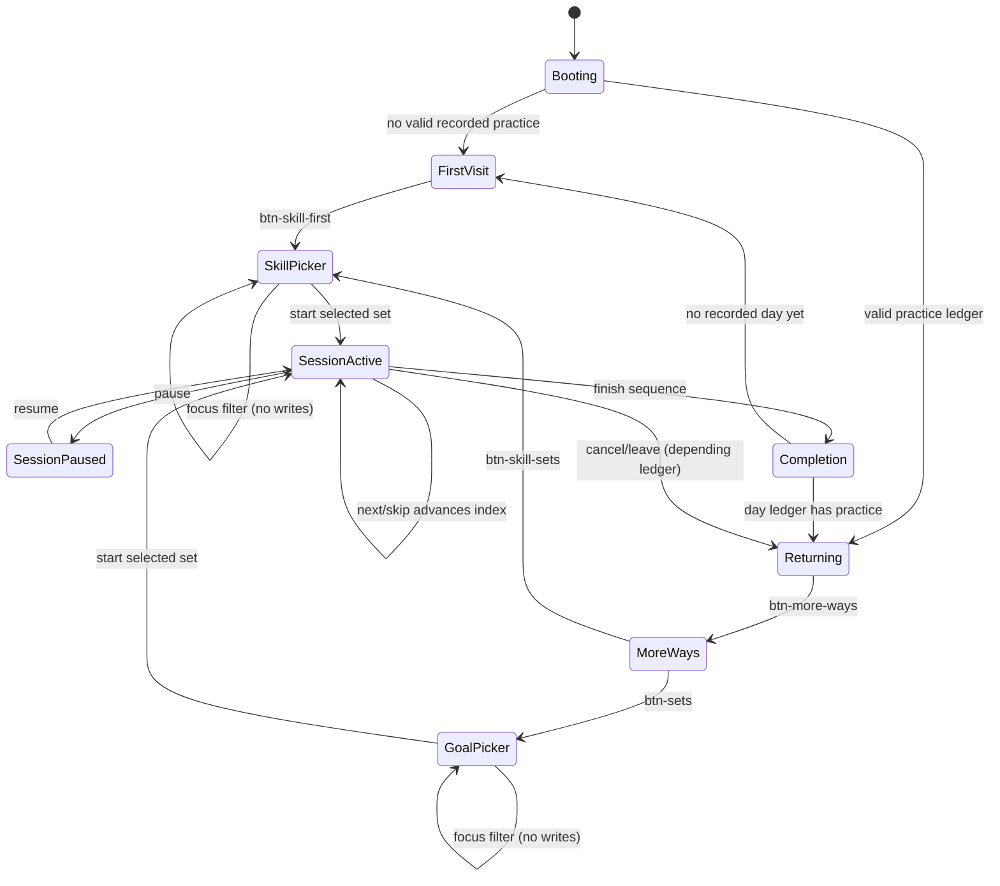
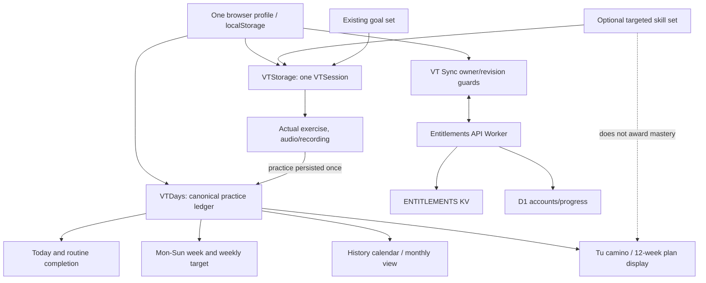
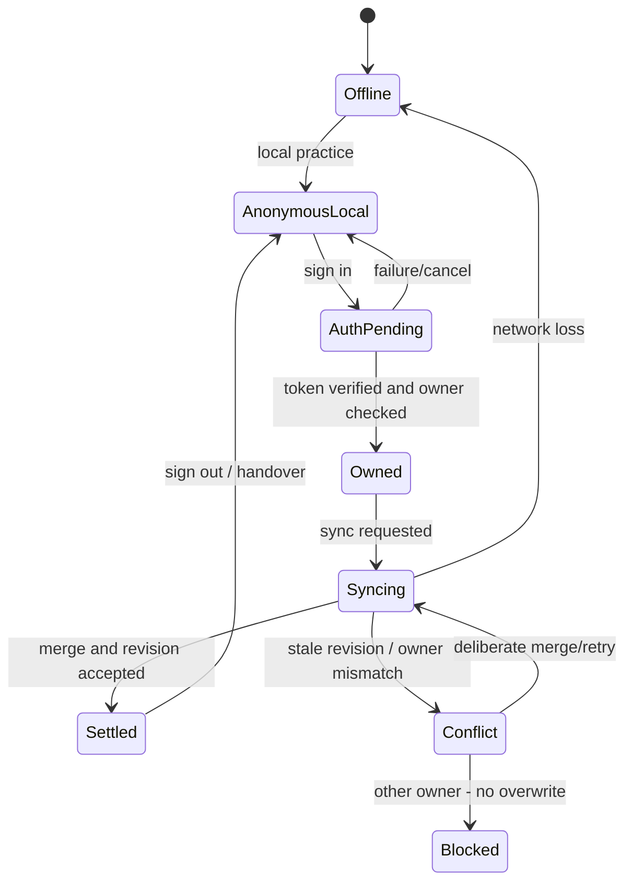
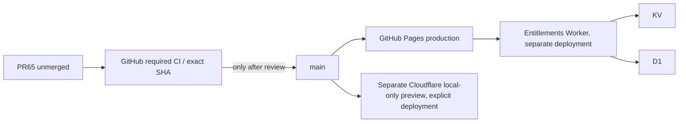

# 58 — Forensic state machines and integrated skill-set QA

**Audit date 2026-11-27** · PR #65 stacked on #64. Status: inspected repository and executed *local Chromium* tests on the feature checkout; **not a production skill-set release**. Sources: js/app.js, js/session.js, js/session-sets.js, js/practice-days.js, js/daily-loop.js, js/voice-path.js, js/storage.js, js/sync.js, workers/entitlements/src, docs/53, 55, 57.

## Verified architectural inventory: explicit and implicit machines

| State owner | States/axes and transitions | Authoritative write and hazards | Verification |
|---|---|---|---|
| Boot/first visit | loading → ready; no practice (`body.loop-first`) → returning (`body.loop-on`); design A/B; ES/EN | browser bootstrap, local profile day ledger; boot timing changes button visibility | Playwright tests/skill-sets.spec.js first/return/320 |
| Navigation | home ↔ exercise ↔ history ↔ plan; design B maps progress subviews; tab singing ↔ speaking | js/app.js, js/site-layout.js; hidden controls must not be clicked | Browser test + existing session-sets, site-version and plan tests |
| Set chooser | closed → open goal/skill → filtered → started → closed; completion → summary → revisit | js/session-sets.js uses shared VTSession, VTDays, focus trap; first visit initially concealed the only skill entry | fixed first visit `#btn-skill-first` + UI/browser tests |
| Guided session | none → active → paused → resumed → step-advanced → completed/cleared | js/session.js localStorage VTStorage; skips are NOT independently performed exercises | real VTSession start/step ID/timer Node and browser tests |
| Practice ledger | absent day → record → daily summary, weekly Mon–Sun states and rest; month/calendar derived | js/practice-days.js; `vt_days_v1` profile scope; beware backfill, timezone, duplicate credit | existing days tests and targeted flow; full cross-tab e2e gate remains |
| Plan and progress | week focus unchosen → chosen → exercise → review → next week/continue; streak/achievements conditional | js/voice-path.js and plan module; skills do not mint mastery / goal-set achievement | deliberate source mutation of `noteGoalCompletion`; VU7 goal-set mutant must still be killed |
| Audio/mic/recording | idle → permission → capturing → interrupted/recovery → review/save/cancel | browser permissions, race between render/take/tab; iOS Safari physical input is an unverified release gate | existing WebKit audio CI, not physical device |
| Identity/profile/sync | anonymous ↔ signed in, profile ownership, remote sync pending → merge → settled/error; account handover | js/sync.js, js/practice-profiles.js; owner guards, revision conflict and logout isolation | existing sync tests; no production account changed in this audit |
| Payments/entitlements | checkout → webhook verified → active/past-due/cancelled/expired/revoked | Worker+KV+D1; idempotency and write order; existing TODO cases must remain visible | payment CI and QA-W-03/W-07/VG-100 remain separately unresolved |
| Deployment | branch/PR → full CI SHA → main → Pages deploy → live SHA verification; Worker deployed separately | GitHub Actions/Pages and Cloudflare Worker; no PR deploy implied by build | docs/53 & 55 deployment registry and live Pages verification |

## Interaction lifecycle and source-of-truth diagrams

## Deployment stack and ownership — no secrets

- Repository and frontend production: https://github.com/PillB/vocal-singing-training and https://pillb.github.io/vocal-singing-training/ (main, GitHub Pages). The deployed production site on this audit lacked the unmerged `btn-skill-sets` entry point.
- Backend: the entitlement API Worker name `vocal-studio-entitlements`, settings under `workers/entitlements/wrangler.toml`, binding `ENTITLEMENTS` KV, optional `DB` D1 database `vocal-studio-accounts`. Actual IDs and secrets are operator-private; checked-in TOML placeholder values must never be mistaken for production binding values.
- Static Cloudflare local-only preview: https://vocal-studio.pablo-illescas-buendia.workers.dev/ (explicit separate origin). It does NOT migrate accounts/progress or replace Pages. A separate replica API health endpoint exists as noted in docs/53.
- Browser local progress: localStorage `vt_*` plus IndexedDB recordings; optional authenticated sync via Worker. OAuth, billing rails and Cloudflare account ownership remain separate operational controls.
- The canonical infrastructure, rollback, and source-of-truth ledger is docs/53-DEPLOYMENT-OWNERSHIP-AND-RECOVERY.md; preview trust and scope in docs/55-CLOUDFLARE-FRONTEND.md. No worker or database was redeployed here.

## Four red-team rounds: falsifiable contracts, results, remaining risk

**R1 / Reachability and lifecycle.** Attack: a first-time profile has zero practice days, so CSS hides the only skill entry. Observed in real Playwright checkout: `body.loop-first #start-panel .more-ways {display:none}`. Fix: a separate, optional 44px `btn-skill-first`, hidden for returning learners. Tests cover first-time, returning and EN 320px. Do NOT simply force-click a hidden control in tests. Remaining: novice pilot and physical Safari.

**R2 / Source contracts and gamification.** Attack: removing the achievement guard incorrectly awards skill mastery; moving the old goal credit line breaks existing VU7 source mutation. Fix: `noteGoalCompletion` function with explicit early exit for skill, preserving exact normal-goal call. Negative source mutation must expose credit error. No parallel score/ledger or 'cured' claim.

**R3 / Day-week-month and profile consistency.** Invariant: the same profile's persisted VTDays drives every view; opening/closing picker changes no practice day; skip/complete is not proof of performance; history and plan must not fabricate additional entries; owner change must not leak other profile. Existing suite tests these pieces, but an exhaustive multi-tab/account/real backend matrix is still pending. Do not call partial coverage end-to-end parity.

**R4 / Deployment, audio and concurrency.** Attack: CI green on a PR while live Pages serves an older SHA, Worker points to different bindings, a tab overwrites newer progress or audio races across iOS Safari. Keep release gated on exact SHA + actual app URL, device input/permissions, user handover, and tested migrations. D1 bindings are HTTP-managed, not a per-request TCP pool to optimize; apply idempotency keys and durable write/retry for webhook side effects, bounded revision/CAS for progress, and outbox only if an actual non-transactional external delivery needs atomic intent. Do not create queues or schema changes without a verified failure mode.

## Active PR overlap and merge strategy

Open at this audit: #65 skill, #64 scientific docs (parent), #63 practice timing/cross tab, #59 take/restore, #58 device UI, #54 billing, #53 BreathFlow retry (stacked on draft #51), #51 draft, #41 older integration. CI per SHA cannot prove integration across them. Compare changed-file contracts, rebase/stack intentional dependencies, rerun on merged tree; do not merge blockers merely because an earlier independent run was green.

## Post-release research gate

The research in docs/57 supports studying SOVT, breath phrasing and motor learning but not a certified individualized intervention. No evidence establishes the new 10 exact sequences as universally efficacious. Instructor-blinded assessment with a novel phrase, pre-defined outcome, retention follow-up and an honest non-response path is necessary before a skill mastery claim. No microphone-only anatomical diagnosis; no points for holding breath, loudness or pushing through pain.
